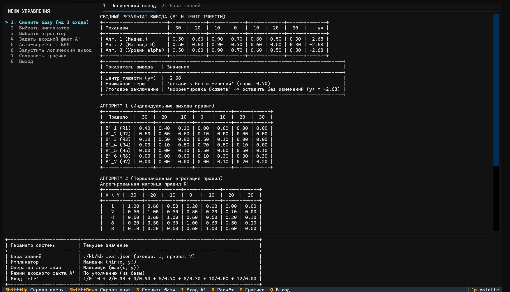
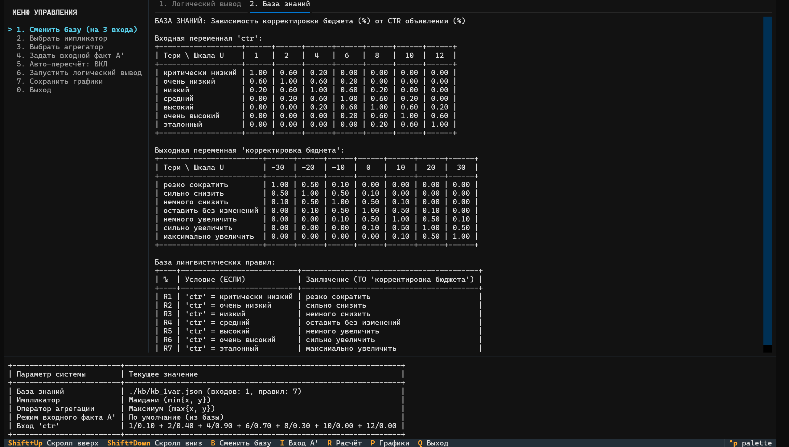
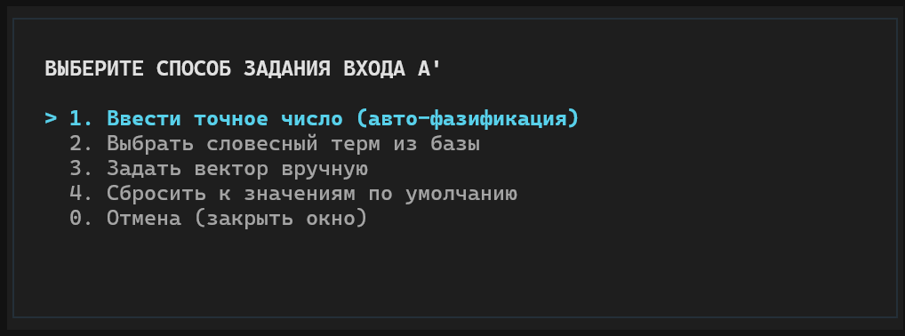
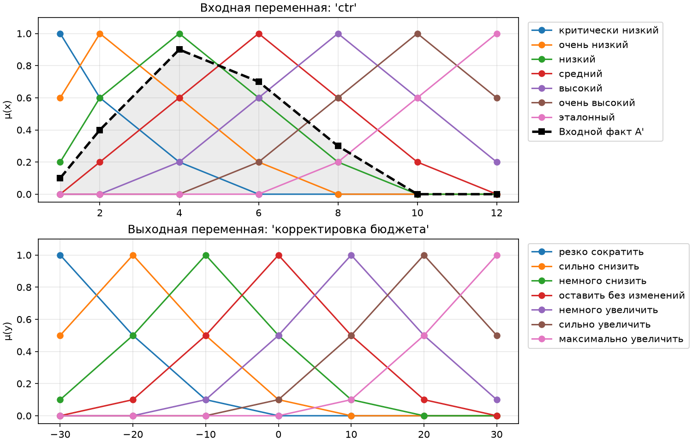
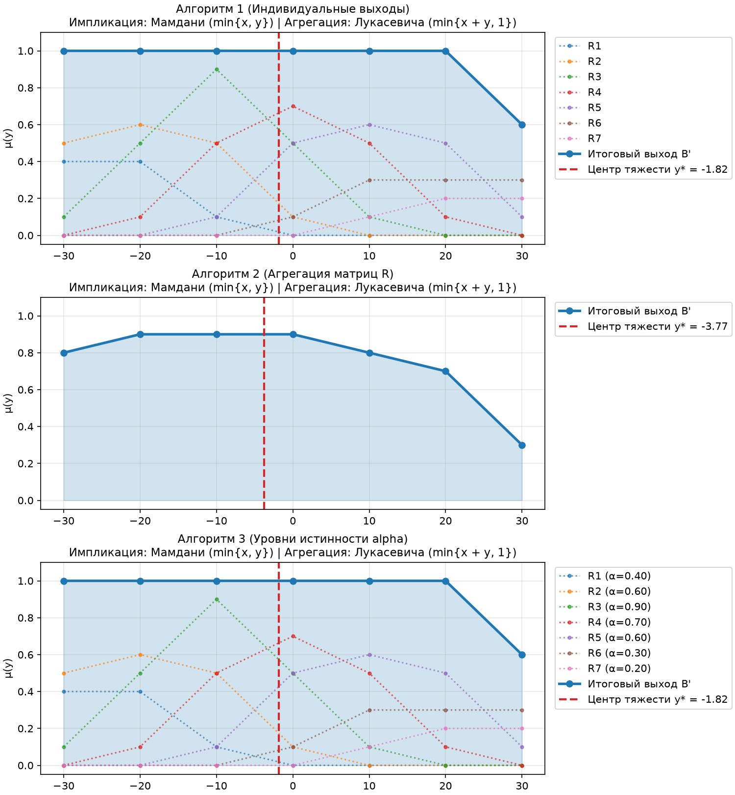
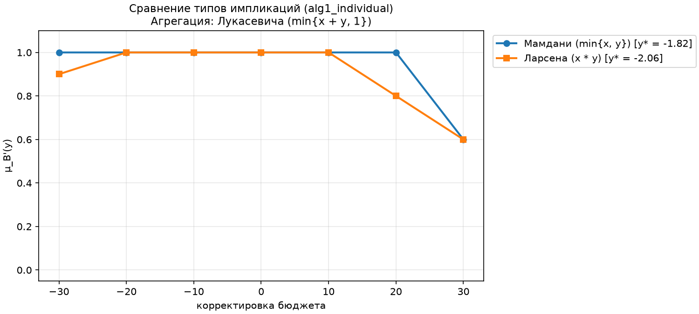
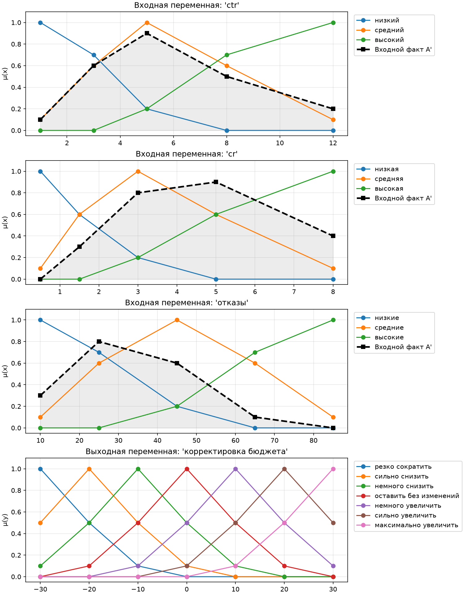
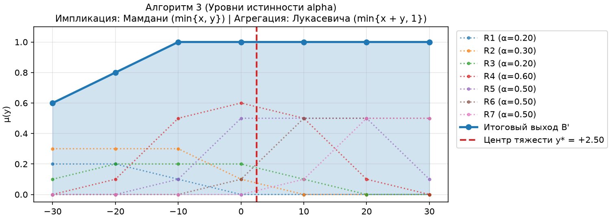
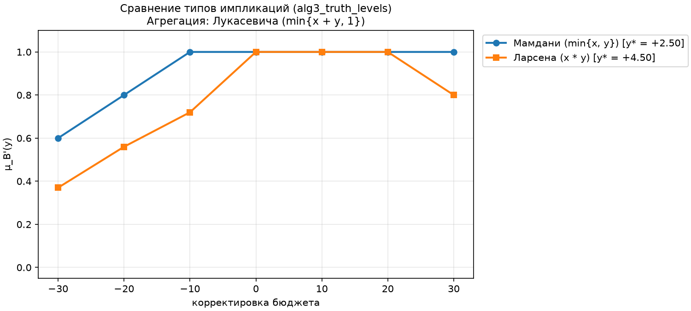

# Лабораторная работа №3. Нечёткие системы логического вывода

Реализация нечёткой системы логического вывода (НСЛВ) для задачи корректировки рекламного бюджета на основе показателей эффективности кампании (CTR, конверсия CR, доля отказов).

В системе реализованы три механизма нечёткого вывода:
1. **Алгоритм 1** — композиционный вывод с вычислением индивидуальных выходов правил ($B'_i = A' \circ R_i$).
2. **Алгоритм 2** — композиционный вывод с первоначальной агрегацией матриц правил ($R = \text{Agg}(R_1, \dots, R_n)$, $B' = A' \circ R$).
3. **Алгоритм 3** — вывод на основе уровней истинности предпосылок правил ($\alpha_i$).

Дефазификация итогового нечёткого множества $B'$ выполняется методом центра тяжести (Center of Gravity, COG).

## Структура проекта

```text
└── lr3/
    ├── main.py                  # Точка входа в приложение
    ├── pyproject.toml           # Настройки линтера Ruff
    ├── requirements.txt         # Зависимости проекта
    ├── kb/
    │   ├── kb_1var.json         # База знаний для 1 входа (CTR -> Бюджет)
    │   └── kb_3vars.json        # База знаний для 3 входов (CTR, CR, Отказы -> Бюджет)
    ├── plots/                   # Сгенерированные графики (.png)
    └── src/
        ├── __init__.py          # Экспорт публичного API пакета
        ├── fuzzy_math.py        # Операторы импликации, агрегации, композиция, COG
        ├── plots.py             # Построение графиков (matplotlib)
        ├── utils.py             # Форматирование матриц/множеств и фазификация чисел
        ├── fuzzy_system/
        │   ├── __init__.py
        │   ├── models.py        # Датаклассы (Variable, Rule, KnowledgeBase, InferenceResult)
        │   ├── engine.py        # Алгоритмы вывода 1, 2, 3 и интерпретация ответа
        │   └── formatters.py    # Сборка таблиц PrettyTable для отчётов
        └── tui/
            ├── __init__.py
            ├── app.py           # Главное окно приложения (Textual)
            ├── modals.py        # Модальные окна выбора операторов и ввода факта A'
            ├── widgets.py       # Виджет списка с текстовым курсором
            └── styles.tcss      # Таблица стилей интерфейса
```

# Развёртывание и запуск
1. Склонируйте репозиторий
```bash
git clone https://github.com/muzilyag/sai_lr3_strukov
```
2. Создайте виртуальное окружение (venv)
```bash
python -m venv .venv
```
3. Активируйте venv
* Windows
```bash
.venv\Scripts\activate
```
* Linux
```bash
source .venv/bin/activate
```
4. Установите зависимости из файла requirements.txt
```bash
pip install -r requirements.txt
```
5. Запустите программу
```bash
python main.py
```


## Интерфейс и дерево переходов меню

Окно программы разделено на три части: слева — меню управления, справа — область вкладок с результатами расчётов и базой знаний, внизу — панель текущего состояния системы.



### Дерево состояний интерфейса

```text
└── Главное окно (FuzzyLogicApp)
    ├── Область вкладок (справа, переключение: Left / Right, скролл: Shift+Up / Shift+Down)
    │   ├── Вкладка «1. Логический вывод»
    │   │   ├── Сводная таблица выходов B' и центров тяжести y*
    │   │   ├── Таблица итогового заключения (ближайший терм и оценка)
    │   │   └── Детализация расчётов по Алгоритмам 1, 2 и 3
    │   └── Вкладка «2. База знаний»
    │       ├── Таблицы функций принадлежности входных переменных
    │       ├── Таблица функций принадлежности выходной переменной
    │       └── Таблица лингвистических правил R1..R7
    │
    ├── Панель состояния системы (внизу экрана)
    │   └── Текущая база, импликатор, агрегатор, режим и векторы входа A'
    │
    └── МЕНЮ УПРАВЛЕНИЯ (слева, навигация: Up / Down, выбор: Enter)
        ├── 1. Сменить базу (на 3 входа / на 1 вход)
        │   └── Переключение между kb_1var.json и kb_3vars.json
        │
        ├── 2. Выбрать импликатор (окно OperatorSelectModal)
        │   ├── 1. Мамдани (min{x, y})
        │   ├── 2. Ларсена (x * y)
        │   └── 0. Назад (без изменений)
        │
        ├── 3. Выбрать агрегатор (окно OperatorSelectModal)
        │   ├── 1. Максимум (max{x, y})
        │   ├── 2. Вероятностная (x + y - x*y)
        │   ├── 3. Лукасевича (min{x + y, 1})
        │   └── 0. Назад (без изменений)
        │
        ├── 4. Задать входной факт A' (окно InputFactModal)
        │   ├── 1. Ввести точное число (авто-фазификация)
        │   │   ├── Поля ввода чисел по каждой входной переменной
        │   │   ├── 1. Применить введённые значения
        │   │   └── 0. Назад (без сохранения)
        │   ├── 2. Выбрать словесный терм из базы
        │   │   └── Пошаговый выбор терма (Шаг 1..N)
        │   │       ├── Список термов текущей переменной
        │   │       └── 0. Назад
        │   ├── 3. Задать вектор вручную
        │   │   ├── Поля ввода степеней принадлежности через пробел
        │   │   ├── 1. Применить введённые значения
        │   │   └── 0. Назад (без сохранения)
        │   ├── 4. Сбросить к значениям по умолчанию
        │   └── 0. Отмена (закрыть окно)
        │
        ├── 5. Авто-пересчёт: ВКЛ / ВЫКЛ
        │   └── Включение/отключение автоматического обновления расчётов
        ├── 6. Запустить логический вывод
        │   └── Принудительный пересчёт таблиц вывода
        ├── 7. Сохранить графики
        │   └── Экспорт 3 графиков в папку ./plots
        └── 0. Выход
```





### Горячие клавиши

| Клавиша | Назначение |
| :--- | :--- |
| `Up` / `Down` | Перемещение курсора по меню и спискам |
| `Enter` | Выбор пункта меню / переход к следующему полю ввода |
| `Left` / `Right` | Переключение вкладок «1. Логический вывод» и «2. База знаний» |
| `Shift+Up` / `Shift+Down` | Прокрутка области отчёта вверх и вниз |
| `Tab` | Переход от полей ввода к списку действий в модальном окне |
| `Esc` | Возврат на шаг назад или закрытие модального окна |
| `B` | Быстрое переключение базы знаний (1 вход / 3 входа) |
| `I` | Открыть окно задания входного факта $A'$ |
| `R` | Выполнить расчёт логического вывода |
| `P` | Сохранить графики в папку `./plots` |
| `Q` | Выход из программы |

## Примеры генерируемых графиков

При выборе пункта `7. Сохранить графики` (или клавиши `P`) в папку `./plots` сохраняются визуализации для активной базы знаний:

### 1. Задача с одной входной переменной (`kb_1var.json`)
* Терм-множества и входной факт $A'$:
  
* Результаты вывода по Алгоритмам 1, 2, 3 и центр тяжести $y^*$:
  
* Сравнение импликаторов:
  

### 2. Задача с тремя входными переменными (`kb_3vars.json`)
* Терм-множества и входные факты $A'_1, A'_2, A'_3$:
  
* Результат вывода по Алгоритму 3 и центр тяжести $y^*$:
  
* Сравнение импликаторов:
  